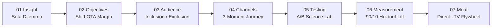

# Limehome Christmas CRM Strategy 2026
> **Strategic Case Study & Direct Booking Growth Engine**  
> Candidate: **Faizan Ahmed** · Role: **CRM Manager (m/f/d)**  
> 🔗 **Live Interactive Cockpit:** [https://faizan021.github.io/limehome-christmas-crm-2026/](https://faizan021.github.io/limehome-christmas-crm-2026/)

---

## 🎯 Executive Summary & Core Insight
Christmas travel is one of the highest-demand windows in European hospitality, driven by family visits, festive markets, and city breaks. While traditional hotel chains default to rate discounting, **Limehome’s opportunity is shifting high-commission OTA demand (15–18% take rate) directly to Limehome while protecting gross room yield**.

### The Strategic North Star
> **“Family for the holidays. Your own space for the night.”**  
> *Celebrate with family all day; retreat to your own quiet, comfortable apartment at night.*

Rather than diluting rates during an inelastic holiday window, we introduce high-utility sleep perks (e.g., **Guaranteed 1:00 PM Late Check-out**) that cost Limehome €0 in rate dilution while delivering genuine guest relief on December 26.

---

## 🧭 The 7-Stage Strategic Architecture



| Stage | Focus Area | Strategic Commercial Lever |
| :--- | :--- | :--- |
| **01 · The Guest Insight** | Customer Psychology | The "Fold-Out Sofa Dilemma": 17M+ Germans travel home for Christmas; 14% lack extra bedrooms. |
| **02 · Objectives & Levers** | Commercial Architecture | Direct booking growth, rate protection, and shifting 15–18% OTA commission fees into direct margin. |
| **03 · Audience Strategy** | Targeting & Restraint | 3 targeted cohorts (*Homecomers, Festive Market Explorers, Direct Opportunity*) + strict negative exclusion logic (GDPR Art. 6/7, German UWG §7(3), active bookings, fatigue suppression). |
| **04 · Timing & Channels** | Multi-Channel Journey | 3 orchestrated moments: **Inspire** (Nov 15–22, Email) → **Decide** (Dec 05–12, Push & In-App) → **Arrive** (Dec 20–24, WhatsApp & GuestHub). |
| **05 · Experimentation Lab** | Scientific Incrementality | 3 isolated commercial tests (*Offer: Perk vs Discount; Creative: Tension vs Features; Journey: 1-Click vs Search*) with 95% significance and auto-pause circuit breakers. |
| **06 · Measurement Framework** | Causal Validation | Destroying the "Attribution Fallacy" via a **90/10 randomized holdout group** and difference-in-differences validation to measure true incremental margin lift (+1,080 causal bookings; +€561,600 GBV). |
| **07 · Collaboration & Moat** | Operational Execution | Cross-functional SLAs across 5 teams (*Brand, Revenue, Ops/Housekeeping, Product/MarTech, Legal/DPO*) culminating in a permanent direct repeat flywheel. |

---

## 📱 Interactive Presentation Features
The interactive cockpit (`index.html`) is built as a responsive, digital-first presentation environment featuring:
* **Interactive Dilemma Switcher (Slide 01):** Compare *Your Own Space* vs. *The Fold-Out Sofa* in real time.
* **Smartphone Simulator (Slide 04):** Test production-grade mockups for **Email**, **iOS 18 Rich Push**, **GuestHub In-App Sheet**, and **Verified WhatsApp Business** messaging.
* **A/B Experimentation Stage (Slide 05):** Toggle live Variant A vs. Variant B treatments across offer economics, creative copy, and funnel friction.
* **Econometric Waterfall (Slide 06):** Interactive holdout calculations demonstrating baseline organic conversions vs. causal campaign lift.

---

## 🚀 How to Run Locally

```bash
# Clone the repository
git clone https://github.com/Faizan021/limehome-christmas-crm-2026.git

# Open directly in any modern browser
cd limehome-christmas-crm-2026
start index.html
```

---

## 🔒 Governance & Operational Safeguards
* **GDPR & Privacy:** Full compliance with GDPR Art. 6/7 and German UWG §7(3); zero unconsented marketing.
* **Housekeeping SLA:** Late check-out perks strictly capped at **25% of property capacity** to safeguard turnover cleaning for incoming arrivals.
* **Ad Audience Negative Sync:** Holdout groups synced to Google Ads & Meta Ads to prevent paid remarketing contamination.

---
*Created by **Faizan Ahmed** — Candidate for CRM Manager (m/f/d) · Limehome Case Study 2026*
